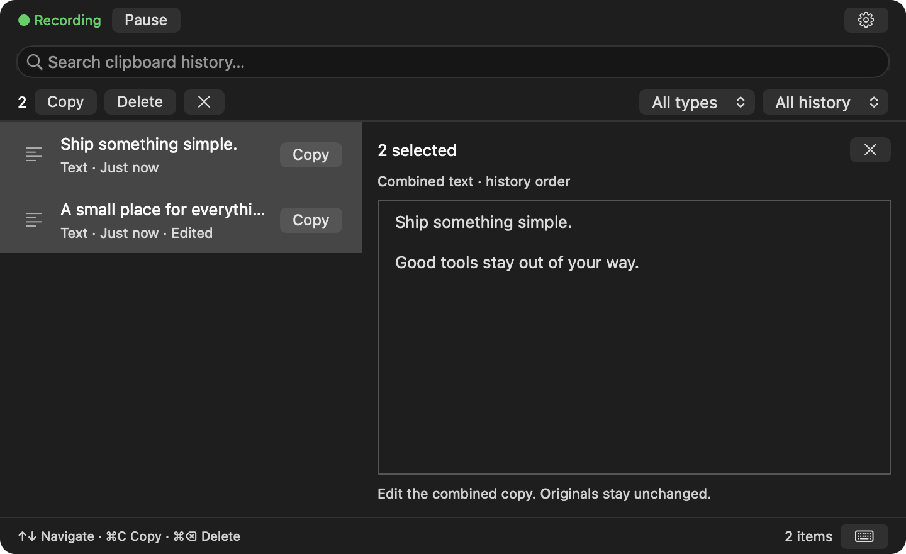
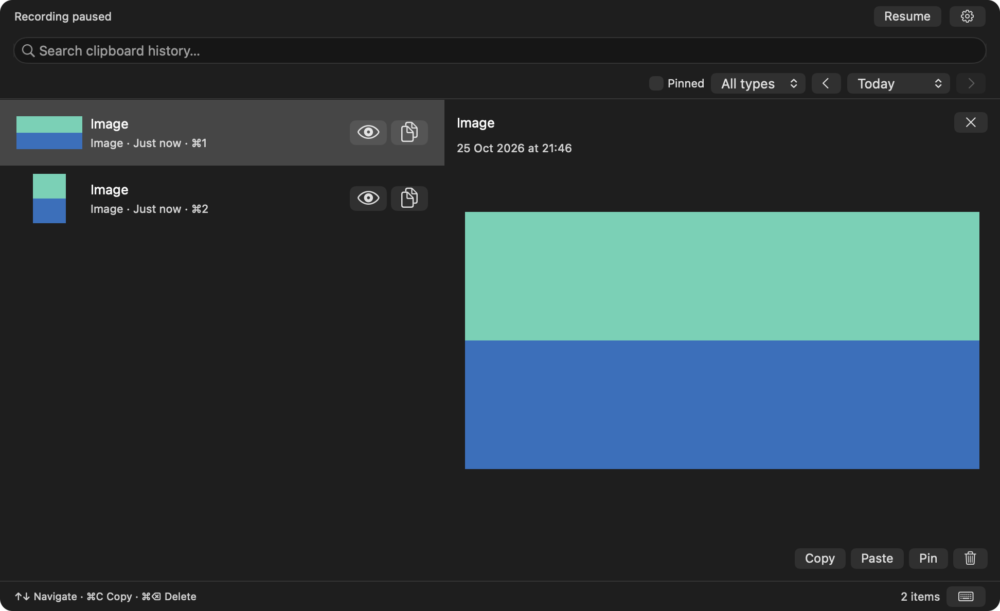

# Clipboard

A small, native clipboard manager for macOS. Find what you copied, edit it, and get back to work.

**macOS 14+ · Apple Silicon & Intel · Swift + AppKit · MIT**

[Download v1.0.4](https://github.com/aagzamov-dev/Clipboard_macos/releases/tag/v1.0.4) · [All releases](https://github.com/aagzamov-dev/Clipboard_macos/releases) · [Report an issue](https://github.com/aagzamov-dev/Clipboard_macos/issues)



Native app screenshots with example clipboard content.

## Quiet by design

- **A compact popup.** Open with **⌥⌘V** or the menu-bar icon. Click outside to dismiss.
- **Useful previews.** A 40% list and 60% preview in a 720 × 440-point window. Images fit without stretching the window.
- **Paste in one click.** Click a row to paste; use the larger right-side Preview and Copy icons for those actions. Automatic paste must be enabled in Permissions.
- **Edit immediately.** Click Preview and start typing. Copy uses your draft; **⌘S** saves it to history.
- **Copy several entries.** Command-click or Shift-click, edit the combined text, then Copy. Original entries stay unchanged.
- **Find and keep.** Search, filter by date/type, and pin favorites. Unpinned history expires after 30 days by default.
- **Your Mac, your history.** No accounts, analytics, or cloud sync. Clipboard contents stay on your Mac. Optional password-encrypted backups.

Built with AppKit and system SQLite. [Sparkle](https://sparkle-project.org) handles authenticated app updates. History loads in bounded pages; image previews downsample to a 1024-pixel edge and release when dismissed. Performance measurements and remaining compatibility checks are documented in [Verification](VERIFICATION.md).

<details>
<summary>Image preview</summary>



</details>

## Install

1. Download **Clipboard-v1.0.4-universal.dmg** from the [release](https://github.com/aagzamov-dev/Clipboard_macos/releases/tag/v1.0.4).
2. Open it and drag **Clipboard.app** into **Applications**. A ZIP is also available.
3. Launch Clipboard and choose **Start local history**. Recording starts automatically on future launches.

**Signing:** v1.0.1 uses an ad-hoc signature and is **not Developer ID signed or notarized**. macOS may block the first launch. Review [Apple’s guidance](https://support.apple.com/en-us/102445) before deciding whether to allow it. Checksums are included with the release; source builds are available too.

If macOS blocks the installed app because it is quarantined, first verify the download against the release checksums and make sure you trust its source. You can then remove the quarantine flag for **Clipboard only** in Terminal:

```sh
xattr -dr com.apple.quarantine "/Applications/Clipboard.app"
```

Open Clipboard again afterward. This removes the quarantine flag; it does **not** sign or notarize the app or verify that it is safe.

To update, quit the running copy before replacing the app. History stays in your Application Support folder.

## Automatic paste

Copy works without Accessibility access. Automatic paste is optional:

1. Open **Settings → General** and enable **Automatic paste**.
2. Choose **Open Accessibility Settings**, then allow Clipboard in **Privacy & Security → Accessibility**. If it is missing, use **+** to select the installed app in Applications.
3. Return to Clipboard. The permission status refreshes automatically. Open your destination app, then choose Paste from Clipboard.

**Settings → Permissions** shows Accessibility trust and Command-V event access separately, the last paste attempt, and the exact running app. **Test automatic paste…** opens a separate test app and verifies one Command-V using private test text; your real clipboard is untouched.

If the Accessibility switch is on but access is still blocked, remove the old Clipboard entry, click **Show this app in Finder**, use **+** to add that exact app, enable it, then quit and reopen Clipboard. Keep one installed copy in Applications. Current releases are ad-hoc signed, so a new build can invalidate an old permission grant. Stable permissions across updates require Developer ID signing.

Clipboard sends Command-V once; the destination controls whether it accepts it. Input Monitoring, Screen Recording, and Full Disk Access are not required.

## Updates

Starting with **v1.0.1**, Clipboard checks GitHub Releases automatically, about once a day. You choose when to install and restart. Open **Settings → Updates** to turn checks off or check now; **Check for Updates…** is also in the menu-bar menu.

Downloads and the update feed are verified with the app’s update-signing key before installation. No clipboard contents are sent; system profiling is disabled. Unsaved edits are protected before restarting.

**Install v1.0.1 manually once if you have v1.0.0.** Older versions do not contain the updater. Update signatures do not replace Apple notarization; this release remains ad-hoc signed and unnotarized.

## Shortcuts

| Shortcut | Action |
| --- | --- |
| ⌥⌘V | Toggle history; configurable in Settings |
| ↑ / ↓, ⇧↑ / ⇧↓ | Navigate or extend selection |
| ⌘C / ⌘⇧C | Copy from the list / copy the current entry or combined draft |
| Enter / ⌘Enter | Paste one selected entry / the current draft |
| ⌘S | Save an individual text draft |
| ⌘P | Pin or unpin one entry |
| ⌘F | Search |
| Delete / ⌘⌫ | Delete selected history entries |
| Escape | Clear bulk selection, close preview, then dismiss |

Text fields retain normal editing shortcuts. Unsaved drafts stay in memory while the popup is dismissed. Quitting offers to save or discard them.

## Privacy

History is local, with private file permissions, but **the database is not encrypted**. Supported confidential markers are skipped; this is not guaranteed secret detection. Original referenced files are never deleted. Read the [privacy and backup details](docs/PRIVACY.md) before storing sensitive content.

## Build and contribute

Open `Clipboard.xcodeproj` with Xcode 27.0, or run:

```sh
Scripts/build.sh
Scripts/test.sh
```

See [Development](docs/DEVELOPMENT.md), [Release process](docs/RELEASING.md), [Changelog](CHANGELOG.md), and [verification status](VERIFICATION.md).

[MIT License](LICENSE)
